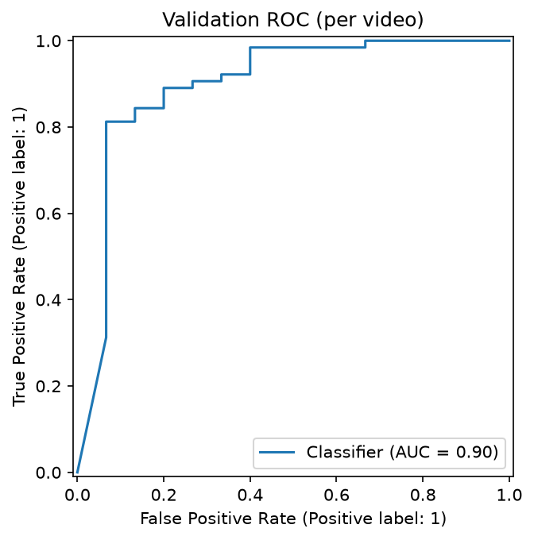
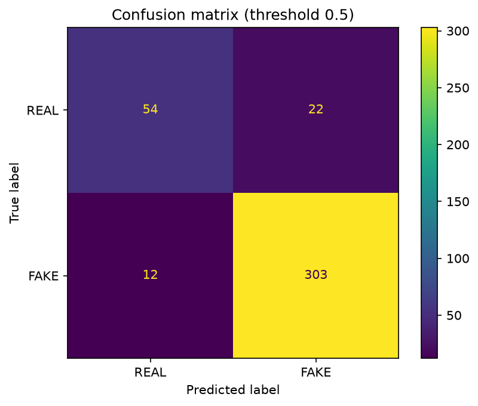

# Deepfake Detection on the DFDC Sample Set

A video-level deepfake detector built on the Kaggle Deepfake Detection Challenge (DFDC) training sample. It extracts face crops, fine-tunes an EfficientNet-B0, and is evaluated with group-aware 5-fold cross-validation.

## Results

Pooled out-of-fold predictions on 391 videos (76 real, 315 fake):

| Metric | Model | Constant-prediction baseline |
|---|---|---|
| Video log loss | **0.293** | 0.493 |
| Video AUC | **0.919** | 0.500 |
| Accuracy at 0.5 | 91.3% | 80.6% |
| Fake recall | 96.2% | n/a |
| Real recall | 71.1% | n/a |

AUC across individual folds ranged from about 0.89 to 0.96, so treat the headline as indicative, not precise.

 

## Approach

1. **Data:** the DFDC training sample (400 videos, 323 fake / 77 real). Nine videos had no detectable face and were excluded, leaving 391.
2. **Face extraction:** 10 evenly spaced frames per video, faces found with MTCNN (largest face per frame), cropped with margin and resized to 224x224.
3. **Model:** ImageNet-pretrained EfficientNet-B0 fine-tuned for 5 epochs (AdamW, cosine schedule, mixed precision) on one RTX 3060.
4. **Video-level prediction:** the mean of a video's crop probabilities.

## Evaluation design

- **Group-aware split.** Each fake in DFDC is made from a real source video. A real video and all fakes derived from it are kept in the same fold, so the model is never tested on a person or scene it saw in training.
- **5-fold cross-validation, fixed epochs.** No epoch or threshold was chosen on the evaluation data. My first single split gave a flattering AUC of 0.965, and cross-validation showed that was on the lucky end.
- **Metrics.** The data is about 81% fake, so accuracy is misleading (always predicting "fake" scores about 81%). I report log loss, the competition metric, with AUC.

## Failure analysis

- Real recall is only 71%: the model leans towards "fake". 8 of the 10 worst errors are real videos flagged as fake.
- Errors are extreme: several videos are wrong with probability above 0.98, which dominates the log loss.
- [Your notes on afoovlsmtx, bilnggbxgu, ciyoudyhly and alninxcyhg.]
- Some videos contain more than one person, so a crop can show an unmanipulated face under a FAKE label (label noise).

## Limitations and next steps

- Small dataset (76 real videos). Results are noisy and come from one dataset, and detectors like this are known to generalise poorly to unseen manipulation methods.
- Per-crop predictions are overconfident; calibration (temperature scaling) is the obvious next step.
- Ideas: temporal models across frames, more training data, stronger augmentation, a larger backbone.

## Reproduce

1. Create the environment and install PyTorch with the CUDA build for your driver, then the packages in `requirements.txt` (see the note at the top of that file).
2. Accept the competition rules on Kaggle and set up the Kaggle API token.
3. `python src/download_data.py`
4. `python src/extract_faces.py`
5. `for f in 0..4: python src/train.py --epochs 5 --fold $f`
6. `python src/evaluate.py`

Paths such as `C:\data\dfdc` are set at the top of each script.

## Data and licence

The DFDC data is not included and may not be redistributed (see the [competition rules](https://www.kaggle.com/competitions/deepfake-detection-challenge/rules)). No video frames or face crops appear in this repo.